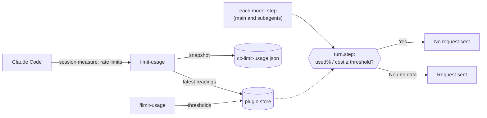

# limit-usage

Stop model requests before you exhaust your Claude usage.

## Overview

Set a threshold and once it is reached, the plugin **stops every model request**, subagents included, so you don't burn through your usage. Two kinds of threshold:

- **Usage %** for a rate-limit window (`5h` / `7d`) — for plans that have a usage quota (Pro / Max / Team / Enterprise).
- **Cost** — this session's **approximate cumulative USD**. Use this when `5h`/`7d` aren't reported, i.e. a plan with no usage quota.

Both figures come from Claude Code itself, so measuring costs **zero extra quota** — no `claude -p`, no OAuth token, no API calls, no statusLine setup. It fails open: with no data, no threshold, or an internal error, requests go through normally.

> **Requires a Claude Code build with mods** (function hooks, early access). On a build without them the plugin loads nothing and stops nothing.

> **`cost` is per-session.** Each session's `cost` limit tracks only that session's own spend. `5h`/`7d` are account-wide, and a reading from one session also guards the others.

## Install

```bash
claude plugin marketplace add pokutuna/claude-plugins
claude plugin install limit-usage@pokutuna-plugins --scope user
```

> **Note:** We recommend `--scope user` (default). See [Recommendation](https://github.com/pokutuna/claude-plugins#recommendation).

## Usage

```
/limit-usage 5h=80             # stop when the 5h window is 80% used (this session)
/limit-usage 5h=80 7d=90       # set both windows in one go
/limit-usage cost=$5           # stop once this session reaches ~$5 (cost=5 / $5 also work)
/limit-usage 7d=90 --global    # apply to all sessions (5h/7d only)
/limit-usage clear             # remove every threshold in effect now (this session + global)
/limit-usage status            # thresholds + current usage
```

For `5h`/`7d` the number is the **used percentage** (0–100): `80` means "80% used / 20% left". A session threshold overrides the global one for the same window. For `cost` it's an **approximate USD** amount Claude Code estimates, so treat it as a rough cap. It is per-session only: `cost` with `--global` is set for the current session.

While a request is being stopped, the plugin's status line under the prompt shows why and how to lift it, e.g. `Blocked: 5h 81.0% >= 80% · resets 18:10 · /limit-usage clear`. The command itself never sends a model request, so it works while blocked.

`5h`/`7d` figures appear after the first API response of any session. If `status` never shows them, your plan has no usage quota — use a `cost` limit instead.

## How it works



1. Before each model request, main loop or subagent, a `turn.step` hook compares current usage against the thresholds. When one is reached it answers the step itself, so no request is sent.
2. Usage is read from Claude Code: the session's own rate limits and cost, plus the latest rate readings other sessions shared. Per window the highest reading whose window has not reset is used.
3. Session thresholds live in the session's plugin state; `--global` thresholds and shared readings live in the plugin store Claude Code manages. The plugin keeps no state file of its own.

### Snapshot for other tools

Each time the rate limits change, the plugin writes `${XDG_STATE_HOME:-~/.local/state}/cc-limit-usage.json`:

```json
{"schema":1,"epoch":1794250515,"rateLimits":[{"kind":"five_hour","percentUsed":25,"resetsAt":"2026-11-09T21:10:00.000Z"}]}
```

It is for display tools only; the guard never reads it. Treat unparsable content or an unknown `schema` as no value.

## Upgrading from 0.4.x

0.4.x captured usage by wrapping your statusLine. After updating:

1. Set `statusLine.command` in `~/.claude/settings.json` back to your original command (the part 0.4.x passed to `statusline-wrapper.sh`).
2. Delete the old state file `${XDG_STATE_HOME:-~/.local/state}/cc-limit-usage.conf` and `~/.claude/plugins/data/limit-usage-pokutuna-plugins/`.

Thresholds are not carried over; set them again with `/limit-usage`.
